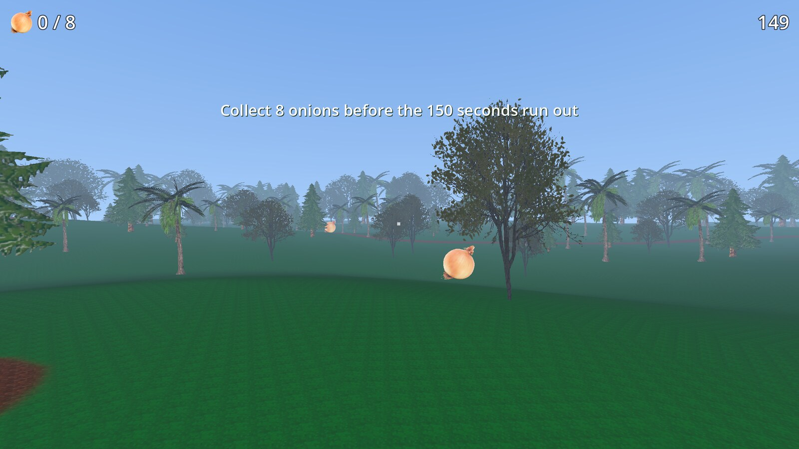
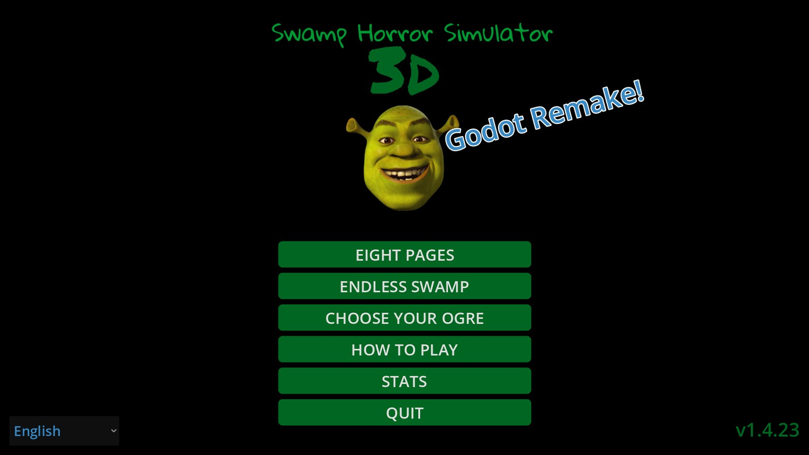
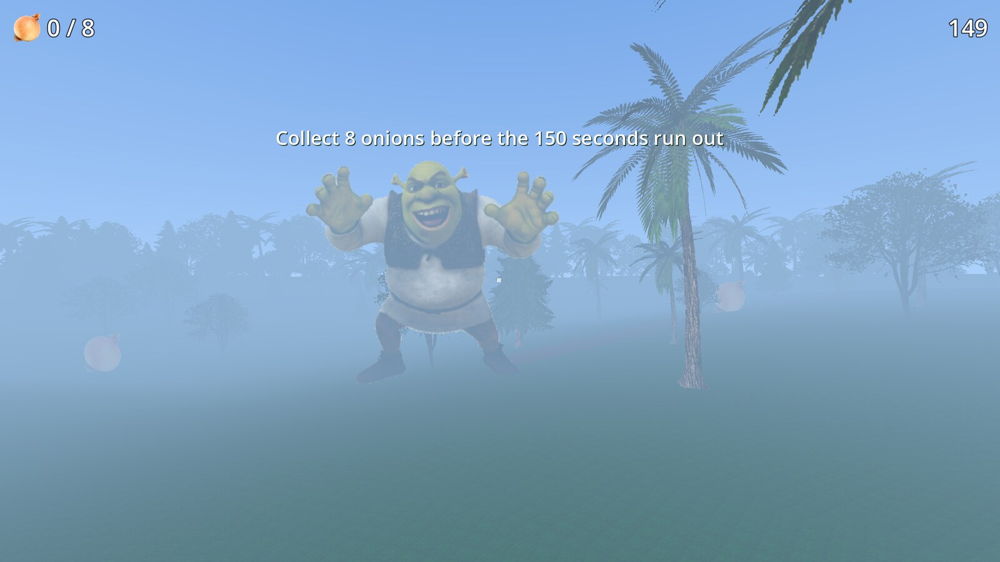

# Swamp Horror Simulator 3D

A short first-person swamp horror game made with Godot 4.7. Collect eight onions before the timer runs out, listen for Shrek in the fog, and keep moving.

**[Android](https://github.com/Matko802/shreksim/releases/latest/download/SwampSim-Android-arm64.apk)** ·
**[Windows](https://github.com/Matko802/shreksim/releases/latest/download/SwampSim-Windows-x86_64.zip)** ·
**[Linux](https://github.com/Matko802/shreksim/releases/latest/download/SwampSim-Linux-x86_64.AppImage)**



## Screenshots

| Menu | Shrek |
| --- | --- |
|  |  |

## Download

| Platform | File | Requirements |
| --- | --- | --- |
| Android | [SwampSim-Android-arm64.apk](https://github.com/Matko802/shreksim/releases/latest/download/SwampSim-Android-arm64.apk) | Android 8+, arm64 |
| Windows | [SwampSim-Windows-x86_64.zip](https://github.com/Matko802/shreksim/releases/latest/download/SwampSim-Windows-x86_64.zip) | Windows 10/11, x64, Vulkan |
| Linux | [SwampSim-Linux-x86_64.AppImage](https://github.com/Matko802/shreksim/releases/latest/download/SwampSim-Linux-x86_64.AppImage) | x86_64 Linux, Vulkan, FUSE |

On Linux, make the AppImage executable and run it:

```bash
chmod +x SwampSim-Linux-x86_64.AppImage
./SwampSim-Linux-x86_64.AppImage
```

## What's new in v1.4.31

- The first onion cutscene now starts Shrek's music immediately and brings him in from the fog instead of popping him in. The camera follows him as he runs toward you, then the cutscene spins you around for the shaking RUN!!! warning.
- When Shrek respawns after an onion, he now runs in from the fog toward his spawn point instead of fading in at close range.
- The world boundary now has animated fog curtains on all four sides, so the invisible collision walls look like the edge of the swamp fog.
- The outer ring of 200 trees now uses the same near and far LODs as every other tree, so they no longer disappear when you get close, and they are named like normal trees.
- Trees now darken with the night phases instead of staying lit after the swamp goes dark.
- Hold C to look behind. While it is held, the camera locks onto Shrek and free-look is disabled, and a direction arrow at the bottom center shows which way you are moving relative to the camera. Your body and movement direction stay the same. Mobile gets a holdable LOOK button.
- C is no longer bound to crouch. Crouch stays on Ctrl.

## What's new in v1.4.30

- Mobile anti-aliasing can no longer be turned off. The Off option is removed from the mobile anti-aliasing list, FXAA is forced, and the remaining MSAA modes are still selectable. This prevents the visual glitching that appeared at native render scale without anti-aliasing.
- Fog is now a depth fog that stays clear through the middle of the view and becomes fully opaque at the effective draw-distance edge, hiding the terrain and tree cutoff without the constant haze of the old exponential fog. The fog edge follows the effective tree draw distance, which is capped at 150 m, and the clear zone gets smaller during the night phases.
- The first onion now triggers a short cutscene: Shrek fades in ahead of you, the camera spins you around, and a shaking RUN!!! warning appears before he starts hunting.
- When Shrek loses you, he sprints off to the edge of the render distance and fades into the fog instead of lingering nearby. If he is hidden when you grab another onion, he fades in smoothly again instead of popping into view.
- Render distance changes update the fog edge immediately.

## What's new in v1.4.29

- Quality presets now change every graphics quality setting at once. Low sets a 64 m render distance, 65% render scale, and anti-aliasing off. Medium sets 128 m, 80%, and FXAA. High sets 200 m, 100%, and FXAA. The render distance, render scale, and anti-aliasing controls update immediately when a preset is selected.
- Mobile still starts on Low (64 m) and PC still starts on High (200 m).

## What's new in v1.4.28

- Removed the floating-origin world shifting entirely. The map, camera, terrain, trees, onions, and Shrek now stay in absolute world coordinates, so there are no 32 m world teleports and no map or camera recentering while moving or turning.
- Terrain3D's clipmap target now follows the player's absolute position directly, so terrain LOD and frustum culling keep working without moving the world.
- Added graphics presets and sliders in the pause menu. Quality Low/Medium/High sets render scale and anti-aliasing, while render distance (48-200 m) and render scale can be adjusted separately. Mobile defaults to Low at 64 m; PC defaults to High at 200 m.
- Catching the player now blinks three static frames at 0.5 seconds each before the game over screen, and the mouse stays unlocked during and after the capture.
- The debug overlay shows 0.1% low FPS instead of maximum frame time.
- The updater now reads GitHub tags first and then releases and the Atom feed, so new tags are detected even before a release is published.
- Added regression tests for the updater, world-space rendering, and the capture sequence.

## What's new in v1.4.26

- Android and desktop share the same rendering: native 1.0 3D render scale, anti-aliasing off by default, a 200 m camera far plane, the same terrain shader, and the same tree draw distances. Android additionally runs 30 Hz physics.
- The terrain shader now uses two albedo fetches per pixel instead of the full Terrain3D per-texture blend. It blends the packed control map bilinearly so path edges stay smooth, and lights the terrain per pixel with Lambert shading. It measured about 2.3x cheaper than the full Terrain3D shader at 1535x864.
- Godot's frustum culling removes terrain chunks behind the camera, and the 200 m far plane removes distant terrain LODs. Terrain collision shapes are 32 m, cutting the number of collision shapes.
- Near trees render only within 32 m and distant trees only within 150 m on both platforms. Both tree LODs now reject out-of-range instances in the vertex shader instead of running the fragment shader just to discard them.
- Android exports are pinned to ETC2/ASTC textures.
- Video settings migrate automatically; an old config resets anti-aliasing and render scale once so PC and mobile match.

## What's new in v1.4.25

- Terrain3D is back on PC and Android, tuned for mobile: a lightweight terrain shader, a 64-region cap, fewer mesh LODs, smaller clipmap meshes, no tessellation, no world-noise background, no cull margin, and dynamic game-only collision. Terrain geometry drops from roughly 166k to 20k primitives.
- Shrek now runs away fast and slowly fades out when he loses you, then stays hidden until you collect another onion. He reappears 20-25 m in front of you, including his first appearance after the first onion.
- The fog no longer thickens when Shrek loses you.
- Android is no longer capped at 60 FPS. It renders at native 1.0 resolution with MSAA 2x by default and the same anti-aliasing options as desktop. Dynamic resolution scaling and FSR are removed.

## About

The swamp is full of onions. Grab all eight before the 150 second timer runs out. Shrek hunts by sound and sight, and the fog thickens as the night goes on. There is also an endless mode for chasing a high score.

The game runs on the Mobile renderer on Android and Forward+ on desktop, with the same terrain shader and tree LOD system. Terrain3D uses a lightweight per-pixel Lambert shader with bilinear control-map blending, plus a mobile-tuned clipmap. Trees use a hybrid LOD system so the forest stays dense without overwhelming low-end phones. Edge fog becomes fully opaque at the draw-distance cutoff so distant terrain and trees never pop in. Quality presets set render distance, render scale, and anti-aliasing together, and each can still be adjusted individually in the pause menu: mobile starts at Low quality and a 64 m render distance, while PC starts at High quality and 200 m. Android runs physics at 30 Hz.

The world uses absolute coordinates. There is no floating-origin shifting or world teleporting: terrain, trees, onions, Shrek, physics, navigation, and the camera all stay in the same coordinate space. Terrain3D's clipmap target follows the player directly, so terrain LOD, bounds, and frustum culling keep working without moving the map.

## Controls

| Action | Key |
| --- | --- |
| Move | WASD / arrow keys |
| Sprint | Shift |
| Crouch | Ctrl |
| Look behind (hold) | C |
| Interact | E |
| Flashlight | F |
| Pause | Esc or P |
| Fullscreen | F11 |
| Zoom | Right mouse button |

## Build from source

You need Godot 4.7 and the matching export templates.

```bash
godot --headless --import
godot --headless --export-release "Linux" builds/linux/SwampSim.x86_64
godot --headless --export-release "Windows" builds/windows/SwampSim.exe
godot --headless --export-release "Android" builds/swampsim.apk
```

The Android preset expects a release keystore in Godot's editor settings. The desktop presets are in `export_presets.cfg`.

## Tests

```bash
godot --headless --path . tests/test_world_space.tscn
godot --headless --path . tests/test_ground.tscn
godot --headless --path . tests/test_tree_lod.tscn
godot --headless --path . tests/test_settings.tscn
godot --headless --path . tests/test_updater.tscn
godot --headless --path . tests/integration_test.tscn
```

## Credits

- Built with [Godot Engine](https://godotengine.org/).
- Terrain powered by [Terrain3D](https://github.com/TokisanGames/Terrain3D).
- Shrek is a fan-made character tribute. This is a free fan project and is not affiliated with DreamWorks.
